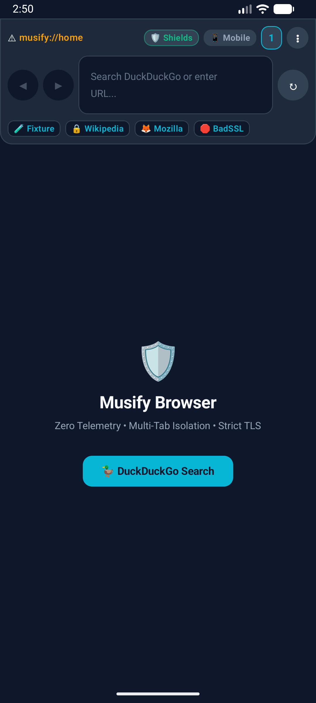
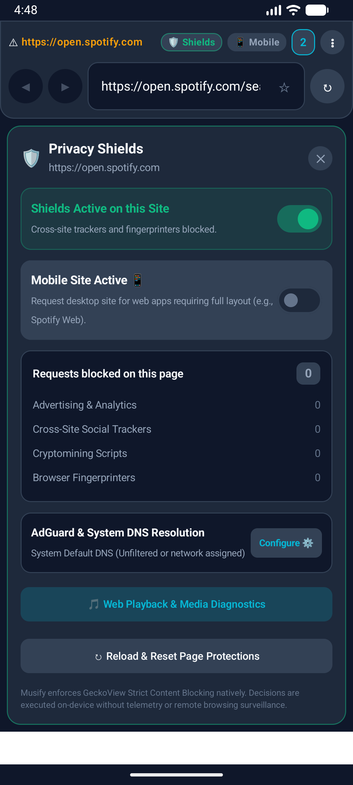
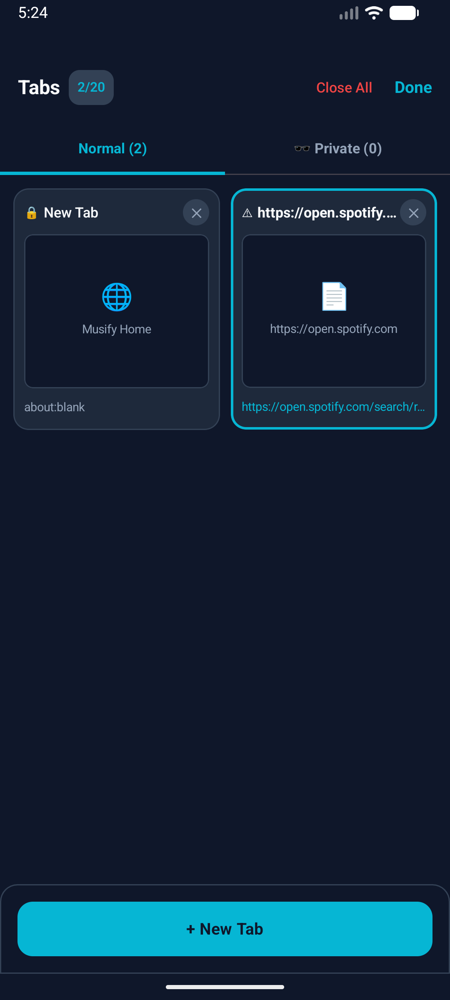
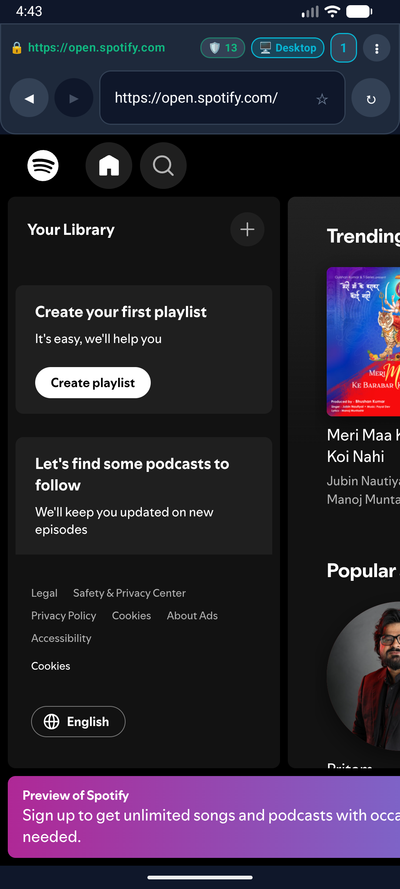

<div align="center">

# 🎵 Musify

### The privacy-first Android browser that loves music.

**Zero telemetry. Strict tracker blocking. HTTPS-first. Real-device compatibility diagnostics.**

[](LICENSE)
[](#-download)
[](#-tech-stack)
[](#-tech-stack)
[](#-tech-stack)
[](#-building--testing)
[](https://github.com/adishxm/Musify/stargazers)

[**⬇️ Download**](#-download) · [**✨ Features**](#-features) · [**🛠️ Build**](#-building--testing) · [**🗺️ Roadmap**](#-roadmap) · [**🤝 Contribute**](#-contributing) · [**⭐ Star History**](#-star-history)

<!-- 📸 SCREENSHOTS: put real images in docs/screenshots/ and these render -->
| 🏠 Home | 🛡️ Shields | 🗂️ Tabs | 🎵 Spotify Web |
|:---:|:---:|:---:|:---:|
|  |  |  |  |

</div>

---

## Why Musify?

Most mobile browsers phone home. Musify doesn't. It's an independent, general-purpose Android browser engineered for **transparent, measurable privacy** — no telemetry, no accounts, no cloud sync, no crypto tokens, no news feed. Just a fast, honest browser with honest, measured media capabilities and transparent engine diagnostics.

## ✨ Features

- 🕵️ **Zero telemetry, zero harvesting** — no behavioral analytics, no ad tracking, no cloud profile sync. All browsing data stays strictly on-device.
- 🛡️ **Privacy Shields** — engine-native strict protection against ad trackers, social trackers, cryptominers & fingerprinters.
- 🎵 **Spotify Web & media diagnostics** — measured hardware Widevine DRM probing (`MediaDrm`), desktop-mode playback recovery, and honest capability badges instead of hardcoded hacks. *Note: Spotify Web compatibility is under device-specific validation; full GeckoView builds are candidates for protected playback. Musify does not bypass DRM.*
- 🌐 **HTTPS-first** — automatic HTTPS upgrades with an explicit warning before any cleartext HTTP load; cleartext disabled in Network Security Config.
- 🔒 **Strict TLS** — enforced certificate validation. Zero silent overrides, no blanket "proceed anyway" SSL button.
- 🗂️ **20-tab architecture** — deterministic tab cap prevents OOM crashes; engine sessions are lazy-allocated and destroyed on tab close.
- ♻️ **Zero-leak session recovery** — restores tabs after process death using only minimal metadata (UUID, URL, title, timestamps) — never DOM content, form entries, cookies or secrets.
- 🚫 **Filter-list pipeline** — memory-bounded offline ABP rule compiler, staged atomic activations, last-known-good rollback, transparent licensing/provenance screens.
- 🔍 **Anti-spoofing omnibar** — displays full verified origin (scheme, host, port) and decodes IDN homoglyphs to Punycode (`xn--…`).
- ⬇️ **Safe downloads** — user-confirmed, off-thread, sandboxed app storage with `FileProvider` mediation and executable threat badges.
- 🎛️ **Per-site control** — reversible per-origin shield exceptions, deny-by-default permissions, fail-closed external scheme protection.
- 📡 **AdGuard DNS companion layer** — system-wide Android Private DNS integration, segregated from in-page Shields counters.
- 🧪 **101/101 unit tests passing** across all development phases.
- 🆓 **Free & open source** — Apache 2.0, independent design & identity.

## ⬇️ Download

| APK | Architecture / Engine | File Size | Direct Download |
|---|---|---|---|
| **[Musify.apk](Musify.apk)** | Universal GeckoView Engine (ARM64, x86_64) | **~153 MB** | [⬇️ Download Universal APK](https://github.com/adishxm/Musify/raw/main/Musify.apk) |
| **[Musify-ARM64.apk](Musify-ARM64.apk)** | Optimized 64-bit GeckoView Engine (arm64-v8a) · Widevine L1/L3 candidate | **~84 MB** | [⬇️ Download ARM64 APK](https://github.com/adishxm/Musify/raw/main/Musify-ARM64.apk) |
| **[Musify-Lite.apk](Musify-Lite.apk)** | **Ultra-Lightweight Edition (18× Smaller!)** · System WebView Engine (Standard web, no Widevine DRM) | **~8.4 MB** | [⬇️ Download Lite APK](https://github.com/adishxm/Musify/raw/main/Musify-Lite.apk) |

> 💡 **Which build should I choose?**
> - **Musify-ARM64.apk (~84 MB)**: Best for all modern 64-bit Android smartphones running the dedicated GeckoView privacy engine with hardware Widevine DRM capabilities.
> - **Musify.apk (~153 MB)**: Universal GeckoView build compatible with all device architectures and emulators.
> - **Musify-Lite.apk (~8.4 MB)**: **10× to 30× smaller in size**. Strips heavy native binaries and omni bundles, running on the native Android System WebView with full ad/tracker Shields protection, instant install, and minimal storage/RAM usage. *Note: Android System WebView does not bundle Widevine CDM; use GeckoView builds for DRM-protected web media.*

Requires **Android 8.0 (API 26)** or later. Sideload, allow the install, done — no account needed.

## 🏗️ Tech Stack

| Layer | Choice |
|---|---|
| Language | **Kotlin 2.0.21** |
| UI | **Jetpack Compose** (Material 3, edge-to-edge) |
| Engine | Decoupled `EngineAdapter` → **GeckoView 135** (primary) + **AndroidX WebKit 1.12.1** (fallback) |
| Build | Gradle 8.13 (Kotlin DSL), AGP 8.13.2 |
| Target / Min SDK | **35 (Android 15)** / **26 (Android 8.0)** |
| JVM | Java 17 / 21 |

## 🛠️ Building & Testing

**Prerequisites:** Android Studio Ladybug/Meerkat (SDK 35, build-tools 35.0.0+), JDK 17 or 21.

```bash
# Run all unit tests (101 tests)
./gradlew testDebugUnitTest

# Debug / release APK
./gradlew assembleDebug
./gradlew assembleRelease

# Install on a connected device
./gradlew installDebug
```

## 🗺️ Roadmap

Development followed a phased, evidence-based plan — every phase ships with a written verification report in [`.brain/.report/`](.brain/.report/).

| Phase | Scope | Status |
|---|---|---|
| 00–02 | Foundation, engine feasibility, single-tab shell | ✅ Pass |
| 03–04 | Tabs, lifecycle, session recovery, history & bookmarks | ✅ Pass |
| 05–06 | Privacy Shields, filter-list pipeline & licensing gate | ✅ Pass |
| 07–08 | Downloads, permissions, hardening & memory profiling | ✅ Pass |
| 09 | Beta distribution & release readiness | ✅ Pass |
| 10 | **Desktop Content Mode & Playback Recovery** | ⚠️ Implementation verified; real-device validation in progress |
| 11 | **Build Variant & Capability Transparency** | ✅ Pass |
| 12 | **Media-Safe Script Sanitization** | 🔄 In Progress |
| 13 | **Live Engine Policy Isolation** | 🔄 Planned |
| 14 | **Real-Device Verification & Diagnostic Hardening** | 🔄 Planned |

## 🤝 Contributing

Issues and PRs are welcome! Found a site that breaks with Shields on? A playback edge case? Open an issue — measured capability reports > "it doesn't work." See [CONTRIBUTING.md](CONTRIBUTING.md) for guidelines.

## ⭐ Star History

<div align="center">

<a href="https://star-history.com/#adishxm/Musify&Date">
  <picture>
    <source media="(prefers-color-scheme: dark)" srcset="https://api.star-history.com/svg?repos=adishxm/Musify&type=Date&theme=dark" />
    <source media="(prefers-color-scheme: light)" srcset="https://api.star-history.com/svg?repos=adishxm/Musify&type=Date" />
    
  </picture>
</a>

</div>

## 📄 License

[Apache 2.0](LICENSE) — use it, fork it, ship it.

---

<div align="center">
If Musify earned a place on your home screen, a ⭐ tells others it's worth a look.
</div>
