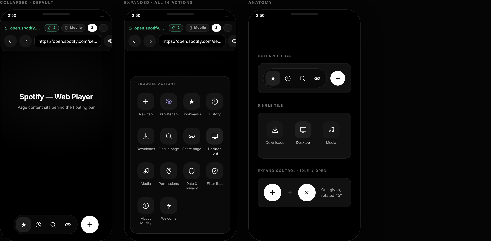
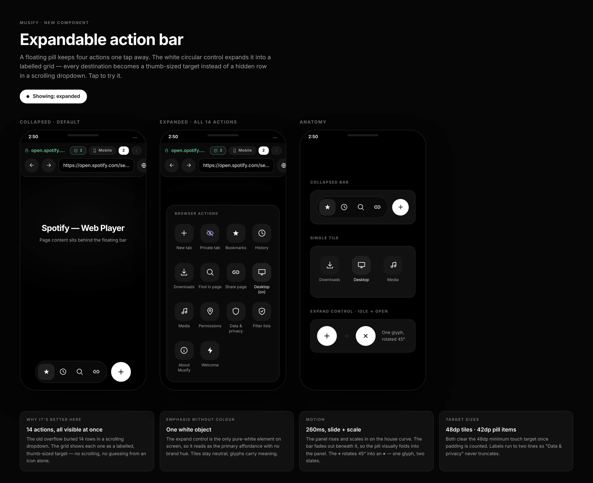
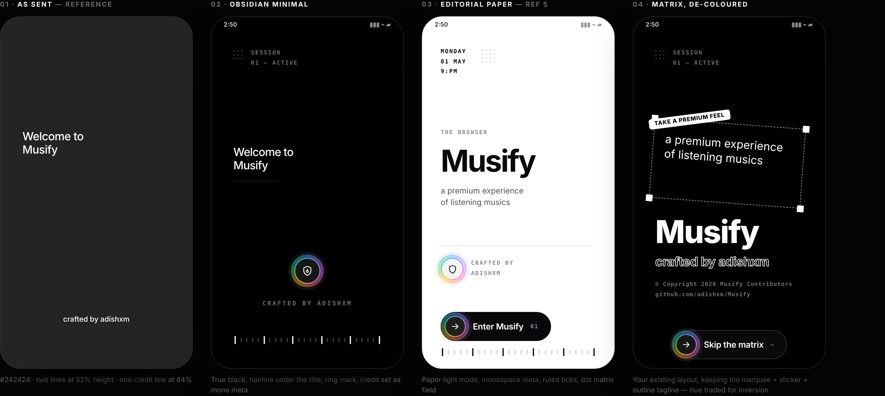

<div align="center">

# 🎵 Musify

### The privacy-first, ad-free Android browser engineered for music and the modern web.

**Zero telemetry · Brave-aligned Shields · Anti-freeze Spotify Web playback · Obsidian Design System**

[](LICENSE)
[](#-download)
[](#-tech-stack)
[](#-tech-stack)
[](#-tech-stack)
[](#-building--testing)
[](https://github.com/adishxm/Musify/stargazers)

[**⬇️ Download APKs**](#-download) · [**✨ Features**](#-features) · [**🛡️ Spotify Ad Blocking**](#-brave-aligned-spotify-ad-blocking) · [**🎨 Design System**](#-obsidian-design-system) · [**🛠️ Build & Test**](#-building--testing) · [**🗺️ Phased Roadmap**](#-roadmap) · [**🤝 Contribute**](#-contributing)

| 🏠 Home | 🛡️ Shields | 🎛️ Action Panel | 🎵 Spotify Web |
|:---:|:---:|:---:|:---:|
|  |  |  |  |

</div>

---

## Why Musify?

Most mobile browsers harvest telemetry, profile users, inject sponsored newsfeeds, and freeze on web media streaming sites.

**Musify is different.** It is an independent, general-purpose native Android browser engineered for transparent, measurable privacy and stutter-free media playback. Built with a decoupled dual-engine architecture (GeckoView 135 + Android System WebKit) and the bespoke **Obsidian Design System**, Musify combines high-performance browsing with specialized, non-destructive content shielding for `open.spotify.com`.

---

## ✨ Features

- 🕵️ **Zero Telemetry & Zero Data Harvesting** — No behavioral trackers, no advertising identifiers, no crash analytics beacons, no cloud accounts. All state lives strictly on your device.
- 🛡️ **Brave-Aligned Privacy Shields** — Engine-level filtering targeting ad networks, cross-site trackers, fingerprinters, and cryptominers.
- 🎵 **Spotify Web & Media Protection** — Brave-inspired multi-tier content shield, declarative cosmetic ad hiding, and synthetic anti-freeze request handling.
- 🎨 **Obsidian Design System** — Minimalist `#242424` launch surface, floating pill `MusifyActionBar`, 14-action quick control grid, custom iridescent glow button, and 44 hand-crafted vector icons.
- 🌐 **HTTPS-First & Enforced Strict TLS** — Automatic HTTPS upgrades with cleartext disabled in the Android Network Security Config. Zero silent SSL overrides.
- 🗂️ **Deterministic 20-Tab Architecture** — Strict memory-capped tab management that lazy-allocates sessions and destroys them upon closure to prevent Android OOM kills.
- ♻️ **Zero-Leak Session Recovery** — Persists and recovers browsing tabs across process restarts using strictly minimal metadata (UUID, URL, title, timestamp) — never DOM trees, form data, cookies, or secrets.
- ⬇️ **Sandboxed Off-Thread Downloads** — User-confirmed background download management mediated via `FileProvider` with file-type inspection and executable threat alerts.
- 📡 **AdGuard DNS Companion Integration** — System-wide Android Private DNS support cleanly separated from in-page Shields metrics.
- 🧪 **159/159 Unit Tests Passing (100% Pass Rate)** — Fully validated across 23 test suites spanning security, engine isolation, media safety, UI components, and network policy.
- 🆓 **100% Free & Open Source** — Licensed under Apache 2.0 with completely independent design and branding.

---

## 🛡️ Brave-Aligned Spotify Ad Blocking

Spotify serves web ads dynamically through internal state machines and backend gateways. Traditional content blockers hard-block `spclient.wg.spotify.com`, triggering Spotify's anti-adblock detection and putting the player into an infinite **"Playback Paused" freeze loop**. 

Musify implements the multi-tier blocking architecture inspired by Brave Browser (`adblock-rust`) and uBlock Origin:

1. **Declarative Cosmetic Ad Hiding (`spotify_adblock.js`):**
   * Early injection at `document_start` via WebExtension (`shields@musify.browser`) and WebView adapter.
   * Suppresses visual ad iframes, companion banners, sponsored playlists, and upsell banners (`[data-testid="ad-companion-banner"]`, `[aria-label="Advertisement"]`, `.Root__ads-container`, `div[data-testid="advertisement-row"]`, `aside[aria-label="Upgrade to Premium"]`).
2. **Anti-Freeze Synthetic Response Engine:**
   * When `spclient.wg.spotify.com/ads` or `/ad-logic` is requested, Musify returns a synthetic `200 OK` empty JSON payload (`{}`) with permissive CORS headers.
   * Satisfies Spotify’s client-side state machine with 0 injected ad tracks, allowing playback to continue uninterrupted without anti-adblock freeze errors.
3. **App-Nag & Scheme Sandboxing:**
   * Intercepts and denies external navigation to `spotify:`, `intent:`, `spotify.link`, and Google Play Store intents, keeping the user in the web player.
   * Hides "Open in App" / "Install App" smart banners and modal popups.
4. **Strict Media Clock & DRM Preservation:**
   * Fully preserves `HTMLMediaElement` clock integrity (no destructive `currentTime = 9999` or forced `playbackRate = 16.0` hacks).
   * Safeguards Widevine Modular DRM CDM key exchanges (`/widevine-license`, `/license`) and CDN audio streams (`audio-fa.scdn.co`, `audio-ak.spotify.com`).

---

## 🎨 Obsidian Design System

Musify features a crafted dark aesthetic built on Jetpack Compose and typography from Google Fonts Inter:

* **Entry Launch Screen:** Clean `#242424` launch surface with two-line typography, creator attribution, and single-tap entry.
* **MusifyActionBar:** Floating bottom pill toolbar with smooth expansion, glassmorphism surface, Omnibar address field, and one-tap shield status.
* **14-Action Grid Panel:** Quick-access modal grid for New Tab, Private Browsing, Downloads, History, Bookmarks, Desktop Mode, Refresh, Find in Page, Share, DNS Settings, and Privacy Diagnostics.
* **Iridescent Glow Button (`MusifyGlowButton`):** Dynamic sweep gradient button with interactive border illumination.
* **Custom Iconography:** 44 monochrome vector drawables tailored for high-density Android displays.

---

## ⬇️ Download

All release APKs are compiled with release optimizations, signed, and verified with Android SDK `apksigner` (v2 & v3 schemes).

| Release Variant | Artifact File | File Size | Engine Architecture | Best Used For |
|---|---|---|---|---|
| **Musify** (Universal Release) | [**Musify.apk**](Musify.apk) | **9.59 MB** | System WebKit / Android WebView (`WebViewAdapter`) | **Recommended for most users.** Ultra-fast install, 36X smaller download, full ad-shielding. |
| **Musify-Lite** (Featherweight) | [**Musify-Lite.apk**](Musify-Lite.apk) | **9.59 MB** | System WebKit (`BUILD_LITE=true`) | Minimal storage and memory footprint with zero bundled native binaries. |
| **Musify-ARM64** (GeckoView Engine) | [**Musify-ARM64.apk**](Musify-ARM64.apk) | **85.55 MB** | Mozilla GeckoView 135 (`arm64-v8a` compressed) | Modern 64-bit devices requiring full Mozilla Gecko engine and hardware Widevine DRM CDM. |

> **Requirements:** Android 8.0 (API 26) or higher. Sideload the APK and launch immediately — no account, sign-in, or setup required.

---

## 🏗️ Tech Stack

| Layer | Technology |
|---|---|
| **Language** | Kotlin 2.0.21 |
| **UI Framework** | Jetpack Compose (Material 3 BOM 2024.10.01, Edge-to-Edge) |
| **Design System** | Musify Obsidian Design Tokens (`#242424` Surface, Inter Variable Typography) |
| **Engines** | Decoupled `EngineAdapter` → **GeckoView 135** (Primary) & **AndroidX WebKit 1.12.1** (Fallback/Lite) |
| **Ad Blocker** | Brave-Aligned Content Shield (`spotify_adblock.js` + WebExtension + Anti-Freeze Mocking) |
| **Build System** | Gradle 8.13 (Kotlin DSL) + Android Gradle Plugin 8.13.2 |
| **Target / Min SDK** | **Android 15 (API 35)** / **Android 8.0 (API 26)** |
| **JVM Target** | Java 17 / 21 |

---

## 🛠️ Building & Testing

### Prerequisites
* Android Studio Ladybug / Meerkat or command-line SDK tools.
* Android SDK 35 & Build-Tools 35.0.0+.
* JDK 17 or 21.

### Build Commands
```bash
# Run the complete test suite (159 unit tests across 23 test suites)
./gradlew testDebugUnitTest

# Assemble Featherweight / Universal Release APK (9.59 MB)
./gradlew assembleRelease -PBUILD_LITE=true

# Assemble Compressed GeckoView ARM64 Release APK (85.55 MB)
./gradlew assembleRelease -PTARGET_ABI=arm64-v8a

# Install Debug APK to a connected Android device or emulator
./gradlew installDebug
```

---

## 🗺️ Roadmap

Musify is developed through an evidence-based, test-gated phase plan. Every completed phase includes a detailed technical report in [`.brain/.report/`](.brain/.report/):

| Phase | Milestone Scope | Status | Verification Report |
|:---:|---|:---:|---|
| **00–02** | Foundation, GeckoView feasibility spike, and single-tab browser shell | ✅ PASS | [PHASE-00](.brain/.report/PHASE-00-REPORT.md) · [PHASE-01](.brain/.report/PHASE-01-REPORT.md) · [PHASE-02](.brain/.report/PHASE-02-REPORT.md) |
| **03–04** | Multi-tab architecture, session recovery, browsing history & bookmarks | ✅ PASS | [PHASE-03](.brain/.report/PHASE-03-REPORT.md) · [PHASE-04](.brain/.report/PHASE-04-REPORT.md) |
| **05–06** | Privacy Shields, engine content blocking & filter-list pipeline | ✅ PASS | [PHASE-05](.brain/.report/PHASE-05-REPORT.md) · [PHASE-06](.brain/.report/PHASE-06-REPORT.md) |
| **07–08** | Sandboxed downloads, permission gating & memory profiling hardening | ✅ PASS | [PHASE-07](.brain/.report/PHASE-07-REPORT.md) · [PHASE-08](.brain/.report/PHASE-08-REPORT.md) |
| **09–11** | Beta distribution readiness, desktop content mode & capability transparency | ✅ PASS | [PHASE-09](.brain/.report/PHASE-09-REPORT.md) · [PHASE-10](.brain/.report/PHASE-10-REPORT.md) · [PHASE-11](.brain/.report/PHASE-11-REPORT.md) |
| **12–14** | Media-safe script sanitization, engine policy isolation & real-device validation | ✅ PASS | [PHASE-12](.brain/.report/PHASE-12-REPORT.md) · [PHASE-13](.brain/.report/PHASE-13-REPORT.md) · [PHASE-14](.brain/.report/PHASE-14-REPORT.md) |
| **15–17** | Obsidian design tokens, Inter typography, browser chrome & security sheets | ✅ PASS | [PHASE-15](.brain/.report/PHASE-15-REPORT.md) · [PHASE-16](.brain/.report/PHASE-16-REPORT.md) · [PHASE-17](.brain/.report/PHASE-17-REPORT.md) |
| **18–20** | Monochrome screen redesign, floating action bar & minimalist entry launch | ✅ PASS | [PHASE-18](.brain/.report/PHASE-18-REPORT.md) · [PHASE-19](.brain/.report/PHASE-19-REPORT.md) · [PHASE-20](.brain/.report/PHASE-20-REPORT.md) |
| **21** | **Brave-aligned Spotify ad-shielding & non-destructive content scripting** | ✅ PASS | [PHASE-21](.brain/.report/PHASE-21-REPORT.md) |
| **22** | **Spotify network shield harmonization, anti-freeze mocking & packaging** | ✅ PASS | [PHASE-22](.brain/.report/PHASE-22-REPORT.md) |

---

## 🤝 Contributing

Contributions, feedback, and issue reports are always welcome!
- Encountered unexpected ad rendering or broken layout on a site?
- Have an idea for performance or battery efficiency?

Feel free to open an issue or pull request. Please see [CONTRIBUTING.md](CONTRIBUTING.md) for contribution guidelines.

---

## 📄 License

This project is licensed under the [Apache License 2.0](LICENSE) — free to use, inspect, fork, and distribute.
