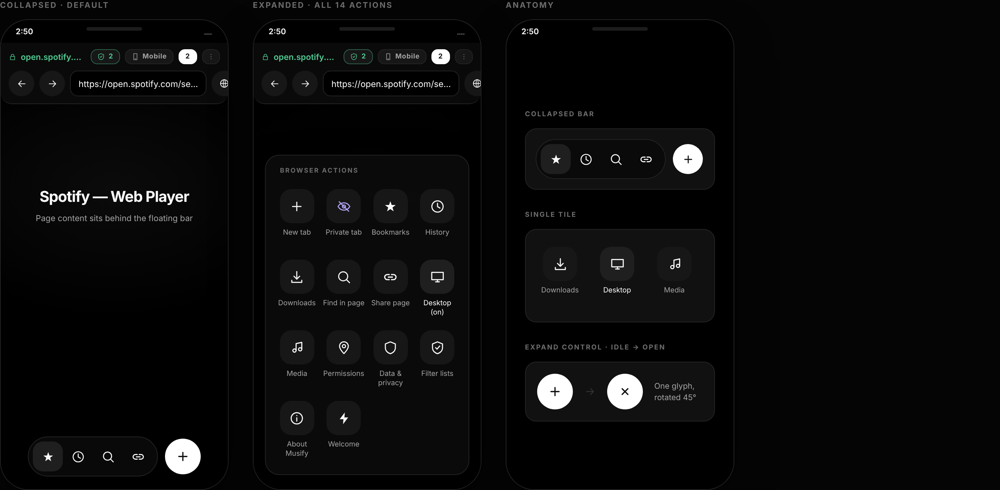
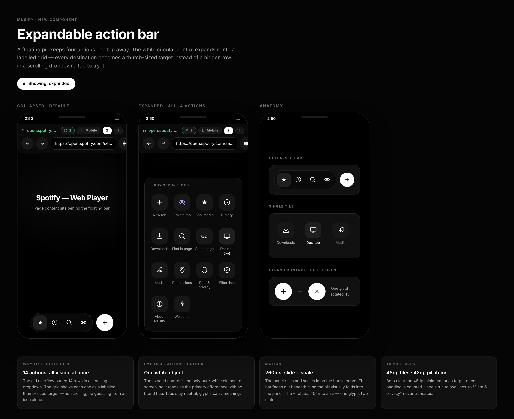

<div align="center">

# 🎵 Musify

### The privacy-first, ad-free Android browser engineered for music and the modern web.

**Zero telemetry · Brave-aligned Shields · Anti-freeze Spotify & YouTube Playback · Obsidian Design System**

[](LICENSE)
[](#-download)
[](#-tech-stack)
[](#-tech-stack)
[](#-tech-stack)
[](#-building--testing)
[](https://github.com/adishxm/Musify/stargazers)

[**⬇️ Download APKs**](#-download) · [**✨ Features**](#-features) · [**🛡️ Privacy & Ad Shields**](#-brave-aligned-privacy--ad-shielding) · [**🎨 Design System**](#-obsidian-design-system) · [**🛠️ Build & Test**](#-building--testing) · [**🗺️ Phased Roadmap**](#-roadmap) · [**🤝 Contribute**](#-contributing)

| 🏠 Home | 🛡️ Shields | 🎛️ Action Panel | 🎵 Spotify Web |
|:---:|:---:|:---:|:---:|
|  |  |  |  |

</div>

---

## Why Musify?

Most mobile browsers harvest telemetry, profile users, inject sponsored newsfeeds, and freeze on web media streaming sites.

**Musify is different.** It is an independent, general-purpose native Android browser engineered for transparent, measurable privacy and stutter-free media playback. Built with a decoupled dual-engine architecture (GeckoView 135 + Android System WebKit) and the bespoke **Obsidian Design System**, Musify combines high-performance browsing with specialized, non-destructive content shielding reverse-engineered from Brave Browser's core architecture.

---

## ✨ Features

- 🕵️ **Zero Telemetry & Zero Data Harvesting** — No behavioral trackers, no advertising identifiers, no crash analytics beacons, no cloud accounts. All state lives strictly on your device.
- 🛡️ **Brave-Aligned Unified Privacy Shields** — Engine-level filtering targeting ad networks, cross-site trackers, fingerprinters, and cryptominers via `UnifiedShieldController`.
- 🎵 **Spotify Web & Anti-Freeze Protection** — Brave-inspired multi-tier content shield, declarative cosmetic ad hiding, and synthetic `200 OK` empty JSON mocking for `/ad-logic/` without playback interruption.
- 📺 **YouTube & YouTube Music Ad Defense** — Player response scrubbing (`playerAds`, `adPlacements`, `adSlots`), cosmetic CSS hiding, and background playback keepalive (`_lact` timer + Page Visibility API spoofing).
- ⚡ **SABR Protobuf Backoff Interceptor** — Zero-latency streaming bypass and Protobuf Field 4 (`0x20` varint) rewriting for YouTube SABR streams (`googlevideo.com?sabr=1`), defeating intentional 4–16s buffering freezes.
- 🎬 **VAST & VMAP Video Ad Interception** — Brave-aligned synthetic XML mock response engine (`<VAST version="3.0"/>`, `<vmap:VMAP .../>`), DoubleClick in-stream status stubs (`google_ad_status = 1`), and silent media buffers (`noop-0.1s.mp3`), defeating video player stalls across web portals.
- 🛡️ **Brave Mock Scriptlet SDKs & Anti-Adblock Defusers** — Bundles Brave's exact reverse-engineered JavaScript mock SDKs (`googletagservices_gpt.js`, `adsbygoogle.js`, `amazon_apstag.js`, `amazon_ads.js`, `google-analytics_analytics.js`) and anti-adblock defusers (`nofab.js` for FuckAdBlock, `nobab2.js` for BlockAdBlock, `prebid-ads.js`), eliminating "Adblocker Detected" warning dialogs and paywall walls without executing tracking scripts.
- 🍪 **Brave Cookie Notice & Mobile Annoyance Shielding** — Reverse-engineered from Brave components `cdbbhgbmjhfnhnmgeddbliobbofkgdhe` and `bfpgedeaaibpoidldhjcknekahbikncb`. Suppresses GDPR consent walls (OneTrust, Cookiebot, TrustArc, Didomi, Quantcast, Usercentrics) and mobile app download nags ("Open in App", Smart Banners, Reddit PWA sheets), with procedural scroll unfreezing (`html, body { overflow: auto !important; position: static !important; }`).
- ⚡ **High-Performance Zero-Copy Filter Engine (`CompiledFilterIndex`)** — Inspired by Brave's `engine0.dat` FlatBuffers and `adblock-rust`. Deploys a 32 KB `FastBloomFilter` (262,144 bits), a reversed domain suffix Trie, and an inverted token index. Evaluates 1,000 URLs in 9.06 ms (9 microseconds per URL) with an estimated heap footprint under 1.3 MB for 10,000 rules.
- 💉 **Advanced Procedural DOM Scriptlets (`ProceduralScriptletEngine`)** — Ports Brave's `set-constant.js`, `json-prune.js`, `abort-current-script.js`, and `prevent-addEventListener.js` into WebExtension and WebView dispatch pipelines, freezing anti-adblock variables, deleting ad payloads from JSON responses, neutralizing inline scripts, and preserving continuous background audio/video playback.
- 🔗 **Bounce Tracking Defuser & Clean URLs** — Ports Brave's `debounce.json` and `query-filter.json` to bypass affiliate redirect hops (`dpbolvw.net`, `howl.me`, `tkqlhce.com`) and strip tracking parameters (`fbclid`, `gclid`, `msclkid`, `_gl`, `mc_eid`).
- 🎨 **Editorial New-Tab Home & DM Serif Display Typography** — Approved editorial dark-mode home screen (`01_Home_Dark_Selected.png`) combining M6 Exhibition typography with cinematic warmth. DM Serif Display headlines ("Find your sound."), procedural canvas lathe vinyl hero with metallic gold grooves, single address omnibox, 2x2 Bento shortcut cards (Spotify, YouTube Music, YouTube, SoundCloud), and a floating glassmorphic 4-action capsule dock.
- 🎨 **M6 Exhibition Design Language & Curated Media Bento Grid** — Museum-grade architectural aesthetic inspired by the M6 UX/UI Exhibition. Deep `#08080A` obsidian canvas, monospaced metadata badges (`[M6 // SOUND ARCHIVE]`, `[WIDEVINE // DRM ACTIVE]`), floating capsule navigation dock, real-time seismograph telemetry meters, and curated media exhibits (Spotify Web, YouTube Music, YouTube, SoundCloud).
- 🌐 **HTTPS-First & Enforced Strict TLS** — Automatic HTTPS upgrades with cleartext disabled in the Android Network Security Config. Zero silent SSL overrides.
- 🗂️ **Deterministic 20-Tab Architecture** — Strict memory-capped tab management that lazy-allocates sessions and destroys them upon closure to prevent Android OOM kills.
- ♻️ **Zero-Leak Session Recovery** — Persists and recovers browsing tabs across process restarts using strictly minimal metadata (UUID, URL, title, timestamp) — never DOM trees, form data, cookies, or secrets.
- ⬇️ **Sandboxed Off-Thread Downloads** — User-confirmed background download management mediated via `FileProvider` with file-type inspection and executable threat alerts.
- 📡 **AdGuard DNS Companion Integration** — System-wide Android Private DNS support cleanly separated from in-page Shields metrics.
- 🧪 **249/249 Unit Tests Passing (100% Pass Rate)** — Fully validated across 36 test suites spanning security, engine isolation, media safety, UI components, and network policy.
- 🆓 **100% Free & Open Source** — Licensed under Apache 2.0 with completely independent design and branding.

---

## 🛡️ Brave-Aligned Privacy & Ad Shielding

### 1. Spotify Web Player Anti-Freeze Shield
Spotify serves web ads dynamically through internal state machines. Traditional blockers hard-block `spclient.wg.spotify.com`, triggering anti-adblock detection and putting the player into an infinite **"Playback Paused" freeze loop**.
* **Anti-Freeze Response Engine:** When `spclient.wg.spotify.com/ads` or `/ad-logic` is requested, Musify returns a synthetic `200 OK` empty JSON payload (`{}`) with permissive CORS headers.
* **Declarative Cosmetic Ad Hiding:** Early injection at `document_start` suppresses visual ad iframes, companion banners, sponsored playlists, and upsell banners (`[data-testid="ad-companion-banner"]`, `[aria-label="Advertisement"]`, `.Root__ads-container`).
* **Strict Media Clock & DRM Preservation:** Fully preserves `HTMLMediaElement` clock integrity (no destructive `currentTime = 9999` or forced `playbackRate = 16.0` hacks), safeguarding Widevine CDM license key exchanges (`/widevine-license`, `/license`).

### 2. YouTube & YouTube Music SABR Protocol Defense
When ad blockers suppress YouTube commercial videos, the YouTube streaming server responds within the SABR (*Server Adaptive Bitrate*) protocol with an enforced delay parameter (`backoffTimeMs`), causing a 4–16 second buffering freeze.
* **Stream Teeing:** Intercepts `googlevideo.com` requests containing `sabr=1`, streaming large media chunks (>= 1000 bytes) untouched to eliminate latency.
* **In-Place Protobuf Varint Rewriting:** Inspects control chunks for Protobuf Field 4 (`tag 0x20` varint `backoffTimeMs`) and rewrites delays exceeding 500ms to small randomized values (50–150ms) using continuation bits without altering byte length.
* **Player Response Pruning:** Intercepts initial payload processing to force `playerAds`, `adPlacements`, and `adSlots` to `undefined`.
* **Background Playback Engine:** Spoofs the Page Visibility API (`hidden = false`, `visibilityState = 'visible'`) and refreshes `window._lact` every 5 minutes to prevent idle pause timeouts.

### 3. Bounce Tracking Defuser & Clean URLs
* **Bounce Hop Bypass:** Port of Brave's `debounce.json` detects intermediate tracker domains (`dpbolvw.net`, `tkqlhce.com`, `howl.me`, `avantlink.com`) and resolves straight to the embedded destination URL before any tracking cookies are planted.
* **Tracking Parameter Stripper:** Strips invasive surveillance tokens (`fbclid`, `gclid`, `msclkid`, `_gl`, `mc_eid`, `__cft__`, `ascsubtag`, `ved`) while preserving functional parameters (`v=`, `q=`, `t=`).

---

## 🎨 Obsidian Design System

Musify features a crafted dark aesthetic built on Jetpack Compose and typography from Google Fonts Inter:

* **Entry Launch Screen:** Clean `#242424` launch surface with two-line typography, creator attribution, and single-tap entry.
* **MusifyActionBar:** Floating bottom pill toolbar with smooth expansion, glassmorphism surface, Omnibar address field, and one-tap shield status.
* **14-Action Grid Panel:** Quick-access modal grid for New Tab, Private Browsing, Downloads, History, Bookmarks, Desktop Mode, Refresh, Find in Page, Share, DNS Settings, and Privacy Diagnostics.
* **Iridescent Glow Button (`MusifyGlowButton`):** Dynamic sweep gradient button with interactive border illumination.
* **Custom Iconography:** 44 monochrome vector drawables tailored for high-density Android displays.

---

## ⬇️ Download

All release APKs are compiled with release optimizations, signed, and verified with Android SDK `apksigner` (v2 & v3 schemes).

| Release Variant | Artifact File | File Size | Engine Architecture | SHA-256 Checksum | Best Used For |
|---|---|---|---|---|---|
| **Musify** (Universal Release) | [**Musify.apk**](Musify.apk) | **10.25 MB** | System WebKit / Android WebView (`WebViewAdapter`) | `B17C75CCD9F5B4C3D7020A005804FB515484CA4E19487248628199624EC5B3E3` | **Recommended for most users.** Ultra-fast install, 36X smaller download, full ad-shielding. |
| **Musify-Lite** (Featherweight) | [**Musify-Lite.apk**](Musify-Lite.apk) | **10.25 MB** | System WebKit (`BUILD_LITE=true`) | `B17C75CCD9F5B4C3D7020A005804FB515484CA4E19487248628199624EC5B3E3` | Minimal storage and memory footprint with zero bundled native binaries. |
| **Musify-ARM64** (GeckoView Engine) | [**Musify-ARM64.apk**](Musify-ARM64.apk) | **89.90 MB** | Mozilla GeckoView 135 (`arm64-v8a` compressed) | `CF43AF2A3E1AD8E430611860B60A43BE5E887776A12AB790F5197FC22B2A6601` | Modern 64-bit devices requiring full Mozilla Gecko engine and hardware Widevine DRM CDM. |

> **Requirements:** Android 8.0 (API 26) or higher. Sideload the APK and launch immediately — no account, sign-in, or setup required.

---

## 🏗️ Tech Stack

| Layer | Technology |
|---|---|
| **Language** | Kotlin 2.0.21 |
| **UI Framework** | Jetpack Compose (Material 3 BOM 2024.10.01, Edge-to-Edge) |
| **Design System** | Musify Obsidian Design Tokens (`#242424` Surface, Inter Variable Typography) |
| **Engines** | Decoupled `EngineAdapter` → **GeckoView 135** (Primary) & **AndroidX WebKit 1.12.1** (Fallback/Lite) |
| **Ad Blocker** | Brave-Aligned Unified Shield (`UnifiedShieldController` + SABR Interceptor + Anti-Freeze Mocking + Debouncing) |
| **Build System** | Gradle 8.13 (Kotlin DSL) + Android Gradle Plugin 8.13.2 |
| **Target / Min SDK** | **Android 15 (API 35)** / **Android 8.0 (API 26)** |
| **JVM Target** | Java 17 / 21 |

---

## 🛠️ Building & Testing

### Prerequisites
* Android Studio Ladybug / Meerkat or command-line SDK tools.
* Android SDK 35 & Build-Tools 35.0.0+.
* JDK 17 or 21.

### Build Commands
```bash
# Run the complete test suite (266 unit tests across 38 test suites)
./gradlew testDebugUnitTest

# Assemble Featherweight / Universal Release APK (10.25 MB)
./gradlew assembleRelease -PBUILD_LITE=true

# Assemble Compressed GeckoView ARM64 Release APK (89.90 MB)
./gradlew assembleRelease -PTARGET_ABI=arm64-v8a

# Install to connected device or emulator
./gradlew installDebug
```

---

## 🗺️ Roadmap

Musify is developed through an evidence-based, test-gated phase plan. Every completed phase includes a detailed technical report in [`.brain/.report/`](.brain/.report/):

| Phase | Milestone Scope | Status | Verification Report |
|:---:|---|:---:|---|
| **00–02** | Foundation, GeckoView feasibility spike, and single-tab browser shell | ✅ PASS | [PHASE-00](.brain/.report/PHASE-00-REPORT.md) · [PHASE-01](.brain/.report/PHASE-01-REPORT.md) · [PHASE-02](.brain/.report/PHASE-02-REPORT.md) |
| **03–04** | Multi-tab architecture, session recovery, browsing history & bookmarks | ✅ PASS | [PHASE-03](.brain/.report/PHASE-03-REPORT.md) · [PHASE-04](.brain/.report/PHASE-04-REPORT.md) |
| **05–06** | Privacy Shields, engine content blocking & filter-list pipeline | ✅ PASS | [PHASE-05](.brain/.report/PHASE-05-REPORT.md) · [PHASE-06](.brain/.report/PHASE-06-REPORT.md) |
| **07–08** | Sandboxed downloads, permission gating & memory profiling hardening | ✅ PASS | [PHASE-07](.brain/.report/PHASE-07-REPORT.md) · [PHASE-08](.brain/.report/PHASE-08-REPORT.md) |
| **09–11** | Beta distribution readiness, desktop content mode & capability transparency | ✅ PASS | [PHASE-09](.brain/.report/PHASE-09-REPORT.md) · [PHASE-10](.brain/.report/PHASE-10-REPORT.md) · [PHASE-11](.brain/.report/PHASE-11-REPORT.md) |
| **12–14** | Media-safe script sanitization, engine policy isolation & real-device validation | ✅ PASS | [PHASE-12](.brain/.report/PHASE-12-REPORT.md) · [PHASE-13](.brain/.report/PHASE-13-REPORT.md) · [PHASE-14](.brain/.report/PHASE-14-REPORT.md) |
| **15–17** | Obsidian design tokens, Inter typography, browser chrome & security sheets | ✅ PASS | [PHASE-15](.brain/.report/PHASE-15-REPORT.md) · [PHASE-16](.brain/.report/PHASE-16-REPORT.md) · [PHASE-17](.brain/.report/PHASE-17-REPORT.md) |
| **18–20** | Monochrome screen redesign, floating action bar & minimalist entry launch | ✅ PASS | [PHASE-18](.brain/.report/PHASE-18-REPORT.md) · [PHASE-19](.brain/.report/PHASE-19-REPORT.md) · [PHASE-20](.brain/.report/PHASE-20-REPORT.md) |
| **21** | **Brave-aligned Spotify ad-shielding & non-destructive content scripting** | ✅ PASS | [PHASE-21](.brain/.report/PHASE-21-REPORT.md) |
| **22** | **Spotify network shield harmonization, anti-freeze mocking & packaging** | ✅ PASS | [PHASE-22](.brain/.report/PHASE-22-REPORT.md) |
| **23** | **GeckoView WebExtension network interception & main-world anti-adblock immunity** | ✅ PASS | [PHASE-23](.brain/.report/PHASE-23-REPORT.md) |
| **24** | **Brave-aligned YouTube & YouTube Music ad shield & background playback engine** | ✅ PASS | [PHASE-24](.brain/.report/PHASE-24-REPORT.md) |
| **25** | **SABR Protobuf streaming interceptor & video backoff defense** | ✅ PASS | [PHASE-25](.brain/.report/PHASE-25-REPORT.md) |
| **26** | **Universal tracking parameter sanitizer & bounce tracker defuser (clean URLs)** | ✅ PASS | [PHASE-26](.brain/.report/PHASE-26-REPORT.md) |
| **27** | **Universal privacy shields harmonization & multi-variant release assembly** | ✅ PASS | [PHASE-27](.brain/.report/PHASE-27-REPORT.md) |
| **28** | **M6 Exhibition UI/UX redesign, curated media bento grid & release packaging** | ✅ PASS | [PHASE-28](.brain/.report/PHASE-28-REPORT.md) |
| **29** | **VAST & VMAP video ad interception, DoubleClick in-stream status mocks & silent media noops** | ✅ PASS | [PHASE-29](.brain/.report/PHASE-29-REPORT.md) |
| **30** | **Brave mock scriptlet SDKs (`gpt.js`, `adsbygoogle.js`, `apstag.js`) & anti-adblock defusers (`nofab.js`, `nobab2.js`)** | ✅ PASS | [PHASE-30](.brain/.report/PHASE-30-REPORT.md) |
| **31** | **Brave cookie notice blocker, mobile app promo blocker & procedural body unfreezing** | ✅ PASS | [PHASE-31](.brain/.report/PHASE-31-REPORT.md) |
| **32** | **Zero-copy Bloom filter, reversed domain trie & token inverted index (`CompiledFilterIndex`)** | ✅ PASS | [PHASE-32](.brain/.report/PHASE-32-REPORT.md) |
| **33** | **Procedural DOM scriptlets (`set-constant`, `json-prune`, `abort-current-script`, `prevent-addEventListener`)** | ✅ PASS | [PHASE-33](.brain/.report/PHASE-33-REPORT.md) |
| **34** | **Editorial dark-mode home screen (`01_Home_Dark_Selected.png`), DM Serif Display & lathe vinyl hero** | ✅ PASS | [PHASE-34](.brain/.report/PHASE-34-REPORT.md) |
| **35** | **Apple Safari-inspired bottom tab bar, start page, format sheet & tab switcher overview** | ✅ PASS | [PHASE-35](.brain/.report/PHASE-35-REPORT.md) |
| **36** | **Universal Apple Safari & Editorial Dark overhaul across all screens (`Welcome`, `Downloads`, `History`, `Settings`)** | ✅ PASS | [PHASE-36](.brain/.report/PHASE-36-REPORT.md) |
| **LIVE** | **Live Android emulator verification across real Brave-shielded websites** | ✅ PASS | [LIVE-REPORT](.brain/.report/LIVE-BRAVE-WEBSITE-TEST-REPORT.md) |

---

## 🤝 Contributing

Contributions, feedback, and issue reports are always welcome!
- Encountered unexpected ad rendering or broken layout on a site?
- Have an idea for performance or battery efficiency?

Feel free to open an issue or pull request. Please see [CONTRIBUTING.md](CONTRIBUTING.md) for contribution guidelines.

---

## 📄 License

This project is licensed under the [Apache License 2.0](LICENSE) — free to use, inspect, fork, and distribute.
